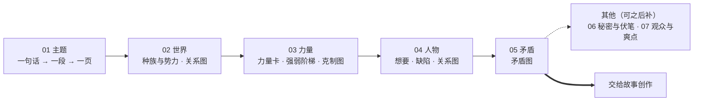

# 西幻新剧开发框架 · v0.4（系列级试点）

用五页搭起一部剧的**核心 mental model**：它关于什么、发生在什么世界、力量怎么运作、谁想要什么、冲突在哪里。每页以一张图为核心，字少、表短。



| 页 | 写什么 | 图 |
|---|---|---|
| [01 主题](templates/01_主题.md) | 一句话 ≤40 字 → 一段 ≤200 字 → 一页 ≤1000 字 | 三级放大卡 |
| [02 世界](templates/02_世界.md) | 舞台、种族与势力、关系、正在发生的变化 | 关系图 + 资料库概念图 |
| [03 力量](templates/03_力量.md) | 力量源与代价、强弱阶梯、克制 | 力量卡 + 阶梯 + 克制图 |
| [04 人物](templates/04_人物.md) | 每人想要什么、缺什么、彼此关系 | 人物关系图 |
| [05 矛盾](templates/05_矛盾.md) | 主要矛盾、矛盾图、内在矛盾 | 矛盾图 |
| 其他 | [06 秘密与伏笔](templates/06_秘密与伏笔.md)、[07 观众与爽点](templates/07_观众与爽点.md) | 以后再补 |

## 三条规则

1. **表格就是图**：作者只填表，管理 UI 自动画图；不用学画图语法。
2. **用库，不重造**：种族、力量先从[西幻公共资料库](../../_shared/xihuan/README.md)挑，写 ID，UI 会配上库里的概念图；库里没有的写「原创」。
3. **不谈季与集**：时间位置用故事阶段（开端、大转折一、中点、大转折二、高潮、结局）；分季分集是下一步故事创作的事。

页序是阅读顺序，不是创作顺序：从哪页起都行（常常是力量或人物），写完按顺序校一遍。

除主题三级外，每页正文不超过 300 字，表格每张不超过 12 行。人物用编号 P01…（P01 是主角）。

## 放在哪、怎么查

开发稿放在 `ai_videos/xihuan/{剧}/0_开发/`，文件名同模板。

```
python ai_videos/xihuan/framework/check.py ai_videos/xihuan/{剧}/0_开发 --json
```

检查：五页齐全、必填小节有内容、篇幅、库 ID 存在、图里的名称和编号都在表里定义过、没有季与集。结果写进 `_check.json`，管理 UI「西幻 → 新剧开发框架」里每份开发稿的「评审」页显示。

## 交接

| 开发稿 | 交到 |
|---|---|
| 主题的一句话 | 剧 README 的「核心：」 |
| 人物的「想要」 | `2_世界观人设/series.md` 人物主目标 |
| 世界、力量里的库 ID | 剧目录 `xihuan_adoption.json` |
| 其他页（补了的话） | Vision 草稿、伏笔账本 |

## 版本

v0.1–v0.3 在《指环王》《权力的游戏》上试套两轮（[试套评估](examples/_评估.md)），证明框架能装下单主角旅程和群像政治剧，并能诊断出天降式解决等结构问题。v0.4（用户 2026-11-08）按「这一层只建核心 mental model」重做：五页核心 + 其他，每页一张图，去掉季集与进阶字段（故事线、外围人物、阴谋表等留给下一步）。两部作品已按 v0.4 重填并复测：五页装得下，天降式解决等诊断仍看得出（主要靠可选的 06 页，建议交接前补上）；矛盾图允许力量源做端点（主角对抗的可能是魔戒这样的东西）。
