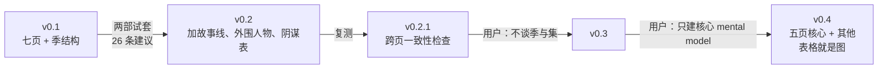

# 试套评估 · 框架 v0.4

**结论：五页核心够用，可以拿来开新剧。** 《指环王》电影三部曲（单主角旅程）和《权力的游戏》HBO 剧（群像政治）都装进了五页加「其他」，形式检查无错误、无提示。每页一张图，几分钟能看完一部剧的骨架。

## 框架诊断出的问题（v0.4 里还看得见）

| 作品 | 问题 | 在哪页看出来 |
|---|---|---|
| 《指环王》 | 亡者大军、巨鹰是天降式解决 | 03 力量卡「代价：不交代」；06 伏笔表（亡者大军到大转折二才第一次提到） |
| 《指环王》 | 真正的主要矛盾是佛罗多对魔戒本身 | 05 矛盾图：v0.4 起允许力量源做端点，图上画成第二条主线 |
| 《权力的游戏》 | 「杀夜王，亡灵全倒」到大转折二才说出 | 03 力量卡（唤尸看不到代价）；06 伏笔表 |
| 《权力的游戏》 | 丹妮莉丝的转变铺垫不足 | 05 矛盾图（「继承权」一线很晚才出现）；06 只有一颗钉子 |

## 哪张图最有用

| 作品 | 最有用 | 为什么 |
|---|---|---|
| 《指环王》 | 力量 · 强弱阶梯 | 按「谁扛得住戒指」排，一眼看出佛罗多从高处跌落 |
| 《权力的游戏》 | 矛盾图 | 两条主线加一圈撞向它们的次线，群像怎样收束一目了然 |

## 砍掉了什么、要不要紧

故事线、外围人物、阴谋表、季规划都移出了这一层，两位试套者都认为留给故事创作就好。有两处要留意：

1. **天降诊断靠可选的 06 页**。不写秘密与伏笔，就看不出「解决办法有没有提前埋」。建议新剧在交给故事创作前补上 06。
2. **IP 核对没有位置**。魔戒命中资料库的组合禁用，这类问题应尽早拦住。新剧用库 ID 时，对照[资料库](../../../_shared/xihuan/README.md)的组合禁用即可，暂不加页。

## 留待以后

| 问题 | 建议 |
|---|---|
| 强弱阶梯、克制图里的名字不受检查 | 这一层故意宽松；跑过一部新剧再定 |
| 知情人只能写势力，丢了具体执行者 | 留给故事创作 |
| 各剧的「原创」条目没汇总 | 有两部以上新剧后汇总成入库候选 |

## 下一步

用框架开一部新剧。用户先给一个起点（一个人物、一个处境或一个画面），再定目标观众；季与集到故事创作再谈。
