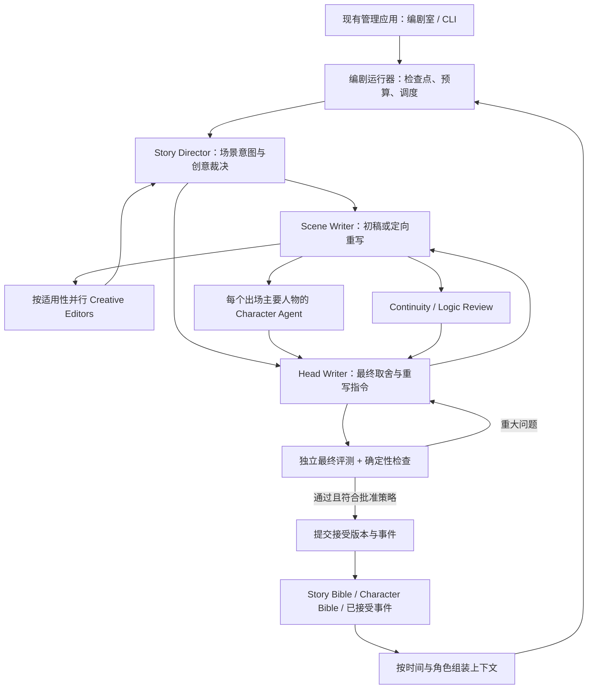

# Multi-Agent 编剧系统 · Technical Design Proposal

本轮只检查当前架构并提出设计。本文不是已批准的实现规格；未修改应用、短剧、人设或现有审查规则，未启动付费模型调用。目标是复用现有平台，实现可恢复、可审计、能连续写剧并维护一致性的编剧系统。

## 1. 现状与推荐结论

### 1.1 实际检查结果

| 方面 | 当前实现 / 证据 | 对设计的影响 |
|---|---|---|
| 管理应用 | `projects/ai_video_management`：FastAPI、Pydantic 2、dependency-injector；`apps/` + `libs/{application,domain,infrastructure,common}` | 编剧功能作为该应用的新聚合加入，不重建应用 |
| UI | React 18、TypeScript、Vite、React Router；`DramaPage`、`DramaDashboard`、`WorkflowPage`、`StageDrawer`、`Editor`、评测页面 | 增加剧目内的编剧室，复用路由、编辑、导航与报告展示 |
| 现有 LLM | `libs/infrastructure/clients/anthropic__client.py`：同步 Messages API，环境变量配置，文本返回；`prompt__query.py` 用于镜头字段建议 | 可保留现有建议功能；编剧调用另加支持结构化输出、usage 和异步的客户端能力 |
| Prompt | `prompt__mapper.py` 里内嵌镜头建议提示；短剧生成 / QC 提示来自 `.claude/skills/` 和 playbooks | 不能直接把镜头字段建议提示当成编剧提示；新提示要有版本和输入输出契约 |
| 独立评测 | `projects/ai_video_eval` 已有 Claude CLI / Anthropic API 两种引擎、异步并发、schema 输出、证据、预算、确定性聚合、争议金标 | 给它增加 story/script 评测入口；保留现有 shot 评测行为，不跨项目直接 import `libs` |
| Agent | 制作流程通过 Claude / Codex skills 调度审稿；应用内未发现持久化的 Character Agent 或 Writer's Room 状态机 | 把角色职责变为可执行调用契约和持久化工作流；不能依赖当前聊天中的子代理长期存活 |
| 其他执行器 | `projects/spec_driven/libs/infrastructure/prompt_lab__executor.py` 用 Claude CLI 启动软件工作区任务 | 其自主开发 / 文件工具权限与本系统不同，不直接拿来作为人物模拟执行器 |
| 数据 | 当前主要是 Markdown、TOML、JSON / JSONL；检查范围内未发现业务 SQLite / PostgreSQL 或 ORM 接入 | 首版采用文件权威源，避免引入第二套真相；以后可加可重建的查询索引 |
| 人物对象 | `character__dto.py` / `character__reader.py` 主要枚举人物建立视频；人物心理资料仍在角色卡 | 新增行为模型，保留现有脸、服装、装备、voice_id 和资产对象 |
| 剧集对象 | `drama_episodes__reader.py` 主要读镜数、定版视频和成片状态 | 新增文学 Scene / Episode 模型，不把 Scene 当成渲染镜头或地点资产 |
| Workflow UI | `WorkflowPage` 消费 `workflowData.ts` 展示步骤及 QC | 是流程说明页面，不能当作已经存在的自动编剧执行引擎 |
| 已有剧本契约 | `tools/script_tools.py`：`script.md` 为台词唯一源，派生 `dialogue.md`，有念白 / 时间窗 / 时长检查 | 保留台词唯一源；新结构化模型不能与 Markdown 双向各自修改 |
| 连贯资料 | `states.toml`、`goals.toml`、`tools/goal_ledger.py`、`tools/dialogue_review.py`；对白 / 观众章绑定当前指纹 | 导入现有账本；新 QA 要绑定输入版本，不能因文件或旧章存在就判通过 |
| 布局 | `drama_layout.py`、`drama_ref.py`、`series_shared.py` 已兼容旧平铺、阶段目录与系列共享资产 | 从现有解析器定位资料，不硬编码所有剧都采用一个目录层级 |

仓库已有大量未提交改动，本轮保留。部分 README / 旧 final spec 与现行代码不一致，例如 README 仍描述早期空 application/domain 和少量接口；本文以实际代码和当前契约为依据。CLI 在 PATH 上可发现，但没有验证登录、订阅余量、配置模型可用性或 API 凭据。配置文件的模型名与价格不等于已验证的可调用能力或现行价格。

### 1.2 推荐架构

**现有管理应用内的编剧运行器 + 文件 Story Memory + 现有独立评测系统扩展。**

首版使用显式 Python 状态机 / DAG，不先引入 LangGraph、CrewAI、AutoGen、Redis、Neo4j 或独立微服务。原因是关键难点是知识边界、审稿证据和版本提交，现有应用的分层、文件与本地任务模式足以承载首个闭环。框架可在确有复杂调度需求时通过运行器接口替换。

本项目采用 Python 3.11+ 运行编剧 worker，与现有评测和 TOML 工具保持兼容；不在本轮调整现有虚拟环境。

## 2. 总体架构与决定权



- Story Director 管场景目标、气氛、节奏和 Creative Debate；决定哪些创意机会值得采用。
- Head Writer / Showrunner 拥有 Agent 中的最终决定权，可以有理由推翻 Director 的创意裁决；不能绕过已批准的世界硬规则、版本冲突、知识来源或必需 QC。
- 用户仍能锁定场景、裁定方向、否决修改。视频生成与成片剪辑继续遵守现有人工关卡。
- Agents 只返回结构化建议、审查结果或候选文本；只有运行器的提交命令能写入正式剧情状态。
- “每个人物一个 Agent”指稳定的人物身份、行为模型和独立输入视图，不意味着为每个人永久开一个进程或保存无限聊天上下文。

## 3. 完整工作流

1. **建立 / 导入 Bible。** 导入 concept、世界规则、人物卡、关系、现有 script / states / goals。标记冲突、未知和待确认，不自动把旧稿及暂停的大纲当成当前事实。人物访谈题库按七大维度展开，每面向 5–10 个问题；资料已有答案不重复问，重点追问能改变行为的分歧。Bible Bootstrap 是能力，不要求新增常驻 Agent。
2. **准备场景上下文。** 固定分支、父 revision、叙事顺序与故事时间。读取当前场景之前已接受的事件及角色状态。组装全局作者视图、人物受限视图与观众屏幕视图。
3. **Director 形成 Scene Brief。** 写目标、冲突、人物各自想得到什么、必须保留事实、可变化范围、长度预算、预期转折和创意适用性；这些是创作意图，不进入已发生事实。
4. **Scene Writer 写初稿。** 输出可观看的动作和对白、稳定 beat / line id，以及候选状态变化。内部目标、策略解释与潜台词标注不出口给观众。
5. **机械预检。** 类型、引用、角色身份、时间、能力取得顺序、明确命题的知识来源、时长估计；输入不完整时输出缺失资料而非让模型捏造。
6. **并行审查。** 适用的 Creative Editors 提机会；出场主要 Character Agents 审行为和语言；Continuity 与 Logic 查跨场、跨集与因果。
7. **有条件的 Creative Debate。** 对同一 beat 的冲突建议由 Director 作一次书面裁决。记录采用、拒绝、延后及理由；不合并所有建议、不组织无限 Agent 对话。无冲突不另加调用。
8. **Head Writer 出 Rewrite Plan。** 区分必须修复与可选创意，保持硬约束、用户锁定项和真人行为目标。必要时选择保留原稿。
9. **定向 Rewrite。** Scene Writer 只按 Plan 修改，输出新 revision、变更清单和候选 Memory Delta。不能用修改 Bible 或状态账本的方法隐藏剧情错误。
10. **Final Validation。** 新文本的受影响角色、知识、关系和因果重新检查；独立评测调用不给作者的论证过程。无修改且输入完全相同的检查在同一运行中无需重做；独立评测的新 run 按现有 eval 全新评审规则执行。
11. **接受与提交。** 必需审查完成、无未解决 blocker / high、父版本与资料哈希仍匹配、Memory Delta 已验证且批准策略允许，才提交。否则输出当前候选及未通过原因。
12. **记忆更新并继续。** 同一提交包含最终剧本版本、事件与状态变化。下一场读新状态。集末另做完整对白通读、冷眼观众和跨集边界审查，不能把所有场景局部通过视作整集通过。

默认最多 3 次重写；同一失败模式连续两轮不改善、单场超过 30 分钟、预算耗尽或上下文矛盾则停止依赖步骤，保留候选、检查点、Assumptions 和问题清单。网络重试与创作重写分开计数；重试也消耗预算。超时和无人回应不是批准。

## 4. Data Model

所有记录带 `schema_version`、稳定 ID、内容哈希、资料来源和 revision。ID 不依赖显示名，人物更名不丢失历史。外部边界用 Pydantic / JSON Schema，domain 用普通强类型实体和 value objects。

| 模型 | 主要字段 / 不变量 |
|---|---|
| StoryBible | story_id、title、genre、audience、language、format、episode_duration、theme、tone、world_rules、factions、places、power_rules、hard_constraints、story_threads、canon_sources、revision |
| CharacterBible | character_id、identity、psychology、cognition、speech、behavior_rules、goal_profile、relationship_defaults、growth_range、canonical_examples、counterexamples、unknowns、source_refs、revision；不含当前场景才发生的知识 |
| CharacterState | character_id、branch、as_of_event、location、physical_condition、inventory_refs、active_goals、emotion_state、stressors、belief_refs、recent_decisions、evidence；与 Bible 分开，按时间查询 |
| RelationshipState | from_character、to_character、as_of_event、trust、respect、affection、fear、resentment、debt、suspicion、dependency、rivalry、public_relationship、private_perception、evidence；A→B 和 B→A 可不同 |
| StoryMemory | branch、head_revision、accepted_event_refs、character_state_projection、relationship_projection、timeline、knowledge_edges、unresolved_threads、foreshadowing、summary_refs；事件为事实依据，摘要为派生导航 |
| StoryEvent | event_id、revision、scene_id、beat_id、narrative_order、story_time/interval、place_id、actors、type、observed_action、effects、source_quote、supersedes；未接受草稿不能生效 |
| Knowledge / Belief | subject、proposition_id、epistemic_status（知道/相信/怀疑/误信/未知）、acquired_at、available_from、source_event、source_type（目睹/告知/推断）、confidence、visibility；推断记录前提，错误认知不变成世界事实 |
| Foreshadowing | id、setup_refs、audience_exposure、character_awareness、planned_payoff、due_range、status（计划/已埋/未回收/已回收/放弃）、payoff_refs；计划 payoff 与已发生事件分开 |
| Episode | id、order、brief、goals、scene_refs、target_duration、opening/ending_state、carry_threads、review_refs、status（草稿/候选通过/批准/锁定） |
| Scene | id、episode_id、place_id、story_time、narrative_order、participants、SceneBrief、script_source、beat/line索引、entry_state、proposed_exit_delta、dependencies、revision、status；一场可映射多镜，场不是地点资产 |
| AgentReview | review_id、role、character/editor_id、scope、input_hash、context_manifest、model、prompt/rubric_version、findings、opportunities、coverage、status、usage、latency；未审维度不打高分 |
| Finding | id、dimension、severity、scene/beat/line定位、quote、rule_ref、reason、source_refs、confidence、repair_hint、resolution、review_hash；证据必须能在当前版本定位 |
| CreativeOpportunity | editor_id、beat_ref、suggestion、intended_effect、character_basis、priority（1–10）、risks、constraints、conflicts_with、decision、decision_reason；priority 是编辑排序，不是客观效果预测 |
| RewriteResult | base_revision、new_revision、applied_plan_refs、text_changes、preserved_constraints、issue_resolutions、candidate_memory_delta、remaining_issues、usage；不能直接更新正式 Memory |
| QualityReport | scope、script_hash、memory_hash、bible_hashes、rubric_version、dimension_scores、confidence、coverage、severity_counts、issues、creative_balance、decision、usage、iteration_history、independent_review_refs |
| Run / TaskCheckpoint | run_id、job_spec_hash、branch、scope、status、step、attempt、lease_owner、heartbeat、budget_used/reserved、completed_call_refs、cancel_requested、assumptions、artifacts；供恢复和停止 |

### 4.1 Character Bible 的可执行细节

- **Core Identity**：自我认知、想让别人看到的形象、价值排序、恐惧失去的东西、遗憾、真实欲望、秘密、不可接受的对待、底线，以及利益/感情/原则冲突的选择例证。
- **Psychology**：desire、fear、pride、shame、jealousy、anger、guilt、attachment、insecurity、defense mechanism、emotional trigger。每条记录触发情境、惯常行为、代价、例外与证据，不只写标签；不强制每个人都有创伤。
- **Cognition**：知识领域、经验、观察、推理、识谎与欺骗方式、盲点和误解。使用具体能力例证，不给“智商 95”之类无法检验的万能数值。当前知识由 CharacterState / Knowledge 表提供。
- **Speech**：词汇层级、句长与节奏倾向、文化与时代表达、惯用表达、愤怒/感情/拒绝/撒谎/求助策略、面对不同关系和压力的变化；给正例和反例。音色仍引用现有 voice_id。
- **Forbidden Speech Patterns**：观众说明书、空洞哲理、总结腔、工整排比、直接说破潜台词、时代错置；可按场景声明有证据的例外，例如训练教学或主动坦白，不能全面禁止人物表达感受。
- **Behavioral Rules**：`trigger + conditions + appraisal + preferred_action + speech_strategy + exceptions + priority + source`；是情境倾向，不是每次触发都机械执行的绝对口令。
- **Goals**：long_term / episode / scene / immediate；external / internal / hidden 分开。每个目标记录追求策略、障碍、可付代价与失败反应。
- **Relationships**：长期模式在 Bible，当前状态和实际变化由关系事件维护。粗粒度 0–4 档可用于排序，必须附行为证据，不把一次道谢自动换算成亲密增长。

例：`被同伴关心 + 当众 + 不愿显得依赖 → 把关心理解为可能暴露软弱 → 用一句玩笑转移，同时允许对方继续包扎`；私下、重伤或已经建立信任时允许不同反应。

人物建立验收包括情境试写：面对朋友、权威和压力；不同人物面对同一困境。检查选择和表达是否有差异、是否能在例外情况下变化。题填满本身不等于人物成立。

## 5. Agent 契约与上下文隔离

| Agent / 能力 | 输入 / 上下文 | 输出 | 负责 | 不负责 |
|---|---|---|---|---|
| Story Director | StoryBible、集 brief、已接受记忆、当前状态、用户锁定、候选创意 | SceneBrief / CreativeDecision | 意图、气氛、叙事取舍、创意冲突裁决 | 写所有台词、提交记忆、绕过硬约束 |
| Scene Writer | Brief、人物行为资料、当前场景上下文、必要的前场衔接、RewritePlan | DraftScene / RewriteResult | 初稿、定向重写、可见动作、对白 | 判定自己通过、私改设定、宣布新事实已接受 |
| Creative Editors | 同一候选场景、该 Editor 的规则、相关人物与关系、已埋伏笔、类型约束 | Opportunities + 风险 / 适用性 | 找机会、说明收益与代价 | 直接改剧本、强加本类元素、改人物能力 |
| Character Agent | 自己 Bible、该时刻 State、已获知信息、对在场者的关系、可感知的动作/对白；按 beat 更新只读模拟视图 | Choice / Speech Findings、自然替代、缺失触发 | 行为、语言、知识、情绪、关系、目标、潜台词 | 使用未来剧情或对方隐藏动机、追求自己永远正确 / 获胜 |
| Continuity Agent | 当前候选、前场/前集边界、记忆事件、状态与关系、timeline、未回收线索 | 连贯 Findings + Delta 核对 | 跨场/集的知识、关系、伤、道具、称呼、伏笔延续 | 改写对白美感、自动改账本让错误消失 |
| Logic Agent | 世界硬规则、能力、空间时间、因果链、人物可用信息与候选 | 因果 Findings、前置缺失 | 结果的可见原因、可执行选择、能力与信息来源、合理失败 | 要求人物永远理性、以全知视角判角色降智 |
| Head Writer | 候选、所有有证据 Findings、Director 的裁决、批准范围 | Decision + RewritePlan | 最终整合、必要取舍、保持统一声调 | 用平均分抵消 blocker、宣称未执行的审查已通过 |
| Final Script QA | 当前最终候选 + 明确允许的已接受资料；无作者对自己修改的辩护 | 独立 QualityReport | 当前版本的综合语义审查、母语口语、OOC与整体质量 | 直接写正式剧本、读无限制作者聊天历史 |
| Cold Viewer | 只拿已抽出的可见动作、对白与观众已经见过的前情 | 可理解性 / 关注与划走问题 | 观众是否能跟上目标、情绪、转折 | 读取秘密、Bible、未来大纲来替画面解释 |
| Memory Committer（确定性代码） | 已通过版本、验证后的 Delta、父 hash、批准策略 | 新 head、事件与投影 | 原子提交、幂等、版本一致性 | 自行创作事实或用摘要填补缺失证据 |

Character Simulation 采用“情境→感知→理解→目标→策略→可见反应”的有界推演。这里区分两种调用：人物一致性审稿可以读当前候选场景，并逐 beat 对照该时点的受限状态；需要检验一个真实选择时，另做决策点 Simulation，只发该决策之前可感知的前缀，不提供后续对白。整场一次审稿不等于逐拍盲模拟，不能宣称隔离了实际已经发给模型的未来信息。默认不每拍模拟；对高风险转折按需增加调用并计入预算。

Character Agent 可指出需要另一个选择，但不强制每拍长篇角色扮演，也不把内部模拟解释变成人物独白。全知校验由 Continuity / Logic 进行，不能把全知包同时塞给人物代理然后靠提示词要求它忘记。

## 6. Creative Editors 与 QA

### 6.1 首版十种 Editor

| Editor | 优先寻找 | 主要风险 |
|---|---|---|
| 搞笑 | 关系反差、误解、嘴硬、短促不合时宜玩笑 | 破坏危险或悲伤的分量 |
| 感人 | 克制照顾、遗憾、小动作、回忆呼应 | 煽情台词代替行为 |
| 兄弟情/友情 | 默契、互坑、共同经历、关键保护 | 未铺垫就生死之交 |
| 战斗 | 目的、能力、环境、空间、策略、结果 | 突增能力、无代价、空间不成立 |
| 爱情 | 试探、边界、错位理解、行动中的偏爱 | 强加 CP、违背关系阶段 |
| 悬疑 | 信息差、合理误导、不确定性、可追踪线索 | 角色无来源全知或为谜故意降智 |
| 成长 | 旧策略失效、代价、选择改变、复发 | 一句话说理就完成成长 |
| 世界观 | 通过任务和行动自然显露规则 | 设定说明书与原典冲突 |
| 伏笔 | 已埋线索、回收时机、行为呼应 | 新加无出处 callback 或强行回收 |
| 视觉叙事 | 用可见动作、空间、道具替代解释 | 观众看不到关键动机或动作无法拍 |

十种都可独立调用、启停和配置。默认根据场景标签及 Brief 选择约 3–5 个；未调用的记录 `not_applicable` 或 `deferred_by_budget`，不能报成已审。类型路由主要由配置和 Director 的 Brief 完成，不为选择 Editor 再增加十次模型调用。存在关键机会但预算不足时明确报告。

### 6.2 质量检查如何成立

| 维度 | 判断依据 | 验证方式 |
|---|---|---|
| OOC | 当前选择与价值、惯常策略、例外、成长阶段是否相容 | 人物代理 + 独立语义 QA，须引用行为/对白与 Bible |
| 自然对白 | 是否回应对方、会不会省略/回避、语域是否母语、是否过度完整 | 整段来回审，不逐句孤立改成漂亮话 |
| AI 味 | 重复、工整总结、空洞哲理、说明书、过度解释、无触发的完美回应 | 可定位的写作症状；不是 AI 来源检测器 |
| 知识一致 | 这一命题何时获得、怎么获得、推断依据是什么 | 已声明命题做时序/来源检查；自然语言隐含泄漏仍需语义审查 |
| 情绪连续 | 触发→人物理解→反应→新策略；上一场余波是否仍在 | 情绪事件证据 + 相邻场复读，不以固定情绪数值要求一致 |
| 关系连续 | 信任或亲密变化是否有事件、观察者感受是否对称 | 有方向的关系 Delta 与行为证据 |
| 剧情逻辑 | 选择基于当时信息、结果有原因、能力/物理状态允许 | 硬规则 + Logic Agent；真实误判不自动算降智 |
| Timeline | 故事时间与叙事顺序、旅行/行动耗时、闪回时间 | ID、区间、前置条件机检；时间不明则存未知，不造精确日期 |
| Pacing | 目标推进、喘息、对白及动作所需时间 | 估计 + 全集节奏审；已有工具是镜头尺度，文学 Scene 不直接套 3–30s |
| 潜台词/视觉叙事 | 意图能否通过话术和行为被观众感知 | 屏幕视图复读；允许需要时主动坦白，不一律删情感表达 |
| 创意平衡 | 相对于类型、场景功能和人物，而非每集元素配额 | Editor 机会 + Director 取舍 + 集级 QA |

硬规则失败、未知来源的重要信息、必需审查未执行、资料自相矛盾、并发输入变化均不能通过。LLM 自信、多个 Agent 同意或高平均分都不能替代证据。高分不能抵消重大问题。

### 6.3 Quality Report

按用户要求保留各维度 0–100 分、`ai_ness` 越低越好。底层采用有锚点的 1–5 rubric，再由代码映射/聚合到 0–100（与现有 eval 思路一致）；报告附置信度、适用性和证据。分数是编辑评估，非概率或客观测量。

以下只展示报告结构，数值是示例，不是当前剧本实测：

```yaml
scope: example/ep01/scene02
decision: rewrite_required
scores:
  character_consistency: 75
  dialogue_naturalness: 50
  emotional_consistency: 75
  relationship_consistency: 75
  knowledge_consistency: 25
  plot_logic: 75
  timeline: 75
  pacing: 75
  creative_balance: 75
  subtext: 50
  visual_storytelling: 75
  ai_ness: 50
coverage:
  character_agents: complete
  final_script_qa: complete
  cold_viewer: pending_episode_review
issues:
  - severity: high
    dimension: knowledge_consistency
    locator: beat06/line12
    quote: "你哥哥昨天已经逃走了。"
    reason: "此人物尚未见到或被告知该事件，也没有足够推断前提。"
    evidence_refs: [event07, character_a_state]
    repair_hint: "改成有依据的怀疑，或增加能被观众看到的信息获得过程。"
```

内部 severity 统一为 blocker/high/medium/low，通过 adapter 映射现有 eval 的 blocker/major/minor，并保留原标签与规则含义；不能仅按总分产生问题。未审维度为 null / 未审，不能默认 100。对 inconclusive 的 Bible 冲突用 `needs_canon_fix`；不拿重写循环解决来源矛盾。用你认可与否决的片段建立争议/金标，校准 OOC、自然度和 AI 味标准。母语对白质量和真实观众吸引力仍以人工反馈及成片观感验证。

## 7. Story Memory、版本与存储

### 7.1 文件权威源与布局

沿用当前阶段目录，设计新增逻辑落点（旧剧由布局 adapter 定位对应阶段，不批量迁移）：

```text
ai_videos/{drama}/
  2_世界观人设/
    story_bible.json
    characters/{existing_character}/character_bible.json
    relationships.md                         # 接管相关段落后为生成的人读投影
  4_剧本/
    writers_room/
      config.toml                           # 模型映射、Editors、预算、批准策略
      memory/branches/{branch}/
        head.json                           # 唯一提交指针
        revisions/{revision}/               # 不可变事件、Delta、快照、资料清单
    episodes/{ep}/
      script.md                             # 当前已提交剧本的唯一对白源
      dialogue.md                           # 仍由 script_tools 生成
      states.toml / goals.toml              # 保留现有契约
      writers_room/
        scenes/{scene_id}.json              # 文学场索引/意图；引用 script 中的文本
        quality_report.json
        quality_report.md
        revisions/{revision}/script.md      # 不可变候选或已接受文本快照
specs/development/ai_video_management/        # 软件需求、设计、Assumptions 与实施验收
specs/ai_video/{drama}/                      # 剧目创作裁定及 changelog
.audit/adhoc_agents/{date}/{run_id}/          # 调用包、实际响应、任务检查点、usage
```

**保留 `script.md` 为台词唯一源。** Scene JSON 保存定位、意图和非对白 metadata，不再保存可独立编辑的台词副本。LLM 临时返回的结构化 Draft / Rewrite 被运行器序列化成候选 script revision；提交版本由候选快照生成当前 script。`dialogue.md` 继续派生。需要改稿时，UI / CLI 都创建新 script revision；外部手改 script 用内容哈希检测，进入导入重审，禁止悄悄用旧结构化缓存覆盖它。

Character Bible 接管行为字段时，旧人物卡相应心理/声口段作为投影生成；脸、服化、装备等仍由现有资产源维护。迁移逐人物/逐集建立 mapping 和冲突报告，采用某个字段的唯一权威源，不同时维护两份手写心理资料。现行世界资料中的版本考据与世界硬规则引用原文件，Story Bible 不另写一个可冲突的副本。

首版 JSON / JSONL / TOML，无业务数据库、无向量库。Knowledge Graph 是有时间与来源的实体/命题/知情边集合，按人物/事件/线程索引就能查询；不是必须使用图数据库。摘要和可选索引都可由接受事件重建，不能替代原始证据。未来如搜索规模需要 SQLite/FTS，只作可重建查询投影；多用户写入和数据库权威源属于后续明确的架构升级。

### 7.2 提交与恢复

- 审查各并行 Agent 读取同一 revision。提交前再验父版本、Bible、世界资料和 script hash；变化则作废相关结论，重新审查。
- 先完整写不可变 revision 与 manifest，经校验后用单个原子 `head.json` 替换作提交点；它同时引用 script 和 Memory Delta。导出当前 script / states / goals 等是可恢复的 materialization；导出未完成时阻止下游生成，不让“记忆已更新但剧本还是旧版”流入制作。
- 编剧提交按剧目/分支单写，带锁/lease、heartbeat 和幂等键；原子换文件只用于提交点，不假称多文件写入天然事务。
- 对同一 run 恢复时复用已完成且哈希相同的调用结果；已发出但未收到结果的调用标 unknown，可能重试并重复消费额度，不能保证外部模型调用 exactly-once。
- 候选 Memory Delta 只含文本可证实的发生事件：别人撒谎的内容写为“听到了这一说法/相信它”，不会成为真实世界事实。未执行的计划不更新记忆。
- 接受场景可推进工作分支；正式集的批准/锁定按用户策略。回改前场用新分支或 supersede 事件，按 dependencies 标记后续状态/审稿 stale，重放和重审，不能仅修改最新摘要。
- 叙事闪回的顺序与故事时间分开；观众知道不代表角色知道。计划中的未来不属于人物可用上下文。
- API/UI 仅通过受控查询访问运行状态、报告和摘要，不把 `.audit` 整个目录加入现有通用文件暴露面；日志不输出密钥，不赋予 Agent 任意文件/网络工具。

## 8. 成本与性能

### 8.1 调用预算示例

以两名主要人物、三个适用 Editor、一场戏为例：

| 阶段 | 调用数 |
|---|---:|
| Scene Brief + Draft | 2 |
| Creative Editors | 3 |
| Character Agents | 2 |
| Continuity + Logic | 2 |
| Head Writer 决策 | 1 |
| 无重写：独立最终场景 QA | 1 |
| 有重写：Writer + 两人物/Continuity/Logic 复核 + 独立最终 QA | 6 |

即**无需重写约 11 次，有一次完整重写约 16 次**；Creative Debate 有实际冲突时再加 1 次。十个 Editor 全启用比三个多 7 次。后续每次完整重写约增加 Head 1 + Writer 1 + 复核 5 = 7 次；仅受影响范围复核时可少些。集级通读、Cold Viewer、人物/Bible 首次建立另算。Memory Delta 随 Writer 结果提出并经复核验证，代码提交不另加 LLM 调用。

这是设计估算，非基准测试，不含按需决策点 Simulation；每个决策点/人物另加一次调用，通常从关键转折开始。若平均每次 6k 输入 / 0.8k 输出 token，则 11–16 次约 66k–96k 输入、8.8k–12.8k 输出；十场一集约十倍，再加集级审查。实际会随剧本长度、人物数量、语言、上下文和重写轮数变化。延迟取决于 provider，需要首轮真实 example 测量，不能把并行后的所有调用时间直接相加。

API 成本按各模型的未缓存输入、缓存写/读、输出及实际 usage 求和；价格配置带来源和更新时间。CLI 订阅引擎记录调用数、token、耗时和额度错误，API 金额记不适用而非“免费”，以调用/token/时间上限止损。API 运行前预留并发请求的最坏支出，运行中硬预算检查；若 usage 不全则标未知并按保守预留计，不默认为零。

### 8.2 模型分配

- 强模型：Director、Draft/Rewrite、Head、主要人物复杂判断、独立最终 QA。
- 较便宜模型：明确规则的 Editor 初筛、结构化抽取、次要人物检查；低置信度或高严重度争议升级强模型。
- 确定性代码：结构/引用/事件顺序/预算/hash/提交/汇总，不用 LLM。
- 每个角色可使用同一个模型、不同上下文；首版无需为了“多 Agent”购买十种模型。
- Provider 接口具备结构化输出、usage、取消/超时、缓存能力探测；CLI 与 API 是不同 adapter。模型配置可扩展，但首版只把选定 provider 跑通，多 provider 不默认全实现。

Anthropic API 可按 JSON Schema 返回结构化输出；这能提高契约可靠性，但不能保证内容正确，还要做来源及业务校验。[官方结构化输出文档](https://platform.claude.com/docs/en/build-with-claude/structured-outputs)。静态提示/Bible 可在 provider 支持且满足条件时使用缓存，是否命中必须查看实际 usage，不从设置了 cache 标记推断折扣。[官方缓存文档](https://platform.claude.com/docs/en/build-with-claude/prompt-caching)。不按仓库旧价格硬编码费用，也不在用户选 provider 前推荐未经验证的具体最新型号。

### 8.3 降低无效消耗

按适用性调用 Editors；只模拟出场主要人物；先跑机检；字段冲突先停；依赖哈希区分受影响复核；场景读相关事件和最近前情，长历史按人物/线程检索；冲突才 Debate；小机会可以“不采用”；未改稿不重写。严重问题不通过截断重要上下文降本。

人物/审稿并行，但同一时间线上的场景接受提交按序；独立分支可并行生成，不能基于未接受前场写入共同正式 Memory。建议 API 全局并发起始 4，CLI 起始 2；独立 eval 的内部并发也纳入运行预算，避免两个 semaphore 各算各的导致失控。实现时按选定后端与限额调参。

## 9. UI、运行方式与扩展

### 9.1 执行方式

在现有应用新增 `apps/writers_room_job/` 薄入口及 application Query / Command。API 创建持久化 JobSpec 并返回 run_id，worker 执行状态机，UI 轮询读状态/报告；长任务不绑定单个 HTTP 请求或只存在于 FastAPI BackgroundTasks。worker 中断后按检查点续跑，不按进程名称杀别的任务。CLI 与 UI 共用同一 Command，不做两套编剧逻辑。

建议受控接口：导入/建立 Bible、创建运行、查询运行/报告、取消、恢复、接受候选、查看记忆 as-of、导入外部修改、估算成本。更新候选和接受版本有父 revision / hash 校验；复用现有 Origin/Host、路径校验与 DI 注册规则。启动 worker 的具体生命周期由实现选择，单机一 worker 先跑通，多机调度以后再加。

UI 在剧目内增加“编剧室”：人物访谈与 Bible、场景列表、稿件对比、按严重度审查、Editor 的采用/拒绝、运行/预算状态、谁何时知道什么、关系变化证据、候选接受和批量范围设置。默认保留本地/light UI。页面展示确实执行的审查、缺失的审查及对应版本，不只是状态机动画。

### 9.2 扩展契约

`AgentSpec = id + role + version + applicability + input_schema + output_schema + context_policy + model_profile + budget + dependencies`。

- 新人物：注册人物 ID 与 Bible 即有新 Character Agent；配角无需复制一份运行器代码。
- 新 Editor/规则/类型：版本化规则与 applicability，可配置；类型 profile 提供语气与元素偏好。
- 新模型：实现 Provider adapter 并探测 capabilities，不让业务层判断各家 SDK 参数。
- 视频/分镜/图像一致性：消费已接受 Scene revision 与资产引用，返回自己的报告；实际视频导入后再更新生产状态，不能把“要求角色拿盾”当作视频已经做到了。
- 输出 MediaTask 不等于执行生成，继续保留“生成永远人点”、animatic、成片 QC、人工剪辑批准和 R2 媒体索引。
- 跨项目交接用 CLI + JSON/manifest，不直接导入两个项目同名 `libs`。独立 eval 增加 story 单元/grounding schema；旧 shot rubric 和调用流程保持原语义。
- 通用评审规则唯一源要明确；skill 给人/代理的解释引用代码 rubric 的 ID，避免技能文字和应用规则各自漂移。只在批准的实施范围内更新 stage2/stage4 与相关审查入口。

## 10. 首版实施顺序与验收

用户回答关键问题后，修订本文并记录 Assumptions，再按以下顺序实施，每步相关检查通过后继续：

1. **数据和版本底座**：Bible、State、Scene索引、事件/知情边、来源、branch/commit、导入适配、schema/invariants。
2. **真实模型闭环**：Provider、Agent契约、十个 Editor、人物模拟、Director/Head、机检、预算、循环和检查点。
3. **独立 QA 与 Memory Commit**：扩展 eval story 模式、证据汇总、状态 Delta 验证、原子提交和 stale 检测。
4. **现有平台 UI + CLI**：运行、查看、diff、报告、接受、停止、恢复；路由/provider/UI exports 同一变更齐备。
5. **真实 Example 与回归**：完成调用、修订、独立 QA、Memory 更新、下一场/下一集消费。无有效模型能力时只能完成确定性部分并报告阻塞，不能以 canned/mock 输出冒充真实演示。

默认 Example 为独立原创、两名主要人物、两集各两场的短篇：第一集建立秘密/误解和救助债，第二集消费有时间边界的知情与关系变化；包含一个明确不应泄露的事实、一次有代价的错误选择、克制友情及战斗机会。示例适配英文对白与中文制作说明以贴近当前作品，也可按用户答案调整。候选故障样本单独作为 QA 对照，不通过故意破坏最终脚本来演示质量。

验收重点：

- 从建立 Character / Story Bible 到 Memory 更新和完整 QualityReport 一条命令跑通，可从 UI 发起。
- 三个以上独立适用 Editor、每个出场主要人物、Continuity/Logic、Head 与独立 QA 真实调用可追踪；十个 Editor 各有可执行定义及适用性检查。
- 未来事件不进入人物上下文；闻听谎言不改成世界事实；无来源泄漏能定位到具体对白。
- 人物错误有可见依据，非凭空降智；重大问题阻止接受，低优先级创意可以被拒绝。
- 重写后前一轮结论过期；缺失审查不算通过；独立评审没有作者对话和工具访问。
- 接受才推进 Memory；重复提交无重复事件；任务中断可恢复；父版本变化会拒绝旧提交。
- 集一的信息、伤情与关系在集二得到正确继承；修改集一会标出依赖场景及审稿 stale。
- 预算/轮数/时间上限确实中止；无关旧剧和媒体不被修改。
- 相关 backend pytest、UI Vitest/build、独立 eval tests、端到端例子和人工 walkthrough 完成。仓库历史记录存在旧失败，本轮未跑测试，不把它们当作当前已验证基线；实施先测相关基线并报告新旧差异。

## 11. Questions for Me

### 必须回答（3 项）

1. **首版真实模型后端**：用现有 Claude CLI 订阅，还是 Anthropic API，或你明确指定的其他 API？推荐先复用 Claude CLI 跑真实闭环；API 的预算/结构化能力更易精确控制。凭据在本机配置，不发到对话。CLI 在 PATH 上不代表已登录，正式运行会先验证选定模型能力。
2. **运行上限**：首次完整 Example 和后续无人值守批量各允许多少预算？API 请给金额上限；CLI 请给可接受调用数/耗时或指定“先限制单场/单集”。建议首次 Example 最多 100 次模型调用、最多 3 次重写/场，逐场 30 分钟熔断；API 金额上限必须由你指定，不能把“自动完成”理解成不限额消费。
3. **自主改动与接受范围**：A）自动重写工作分支，集级通过后等你批准为正式剧情（推荐）；B）在已批准大纲/世界观内自动接受并连续写指定集数；C）还允许自动改变主要动机、关系走向及大纲。选择 B/C 时同时指定无人值守范围（例如下一集/前三集），未指定不得解释为无限自动写完整剧。

### 可选（未回答沿用默认）

- **首个试点**：默认原创四场跨两集 Example，不覆盖现有作品；若希望直接试《圣光刚好够用》，明确剧目/集/场，使用副本/工作分支，既有 concept 与原典规则优先。
- **自然度参照**：给 1–3 段喜欢的对话或本剧最不满意的片段，帮助校准 rubric；默认按现有英文对白、克制友情、中文工作资料开始。
- **交互与访谈偏好**：默认现有 UI + CLI 都可操作；AI 先根据已有资料草拟人物答案，你只处理关键分歧；不逐题反复询问、不审批每次 Editor 调用。

存储、完整历史、Agent进程、是否每轮人工批准、单场并行度等已有合理默认，故不另列几十道架构问卷。用户回答前停在设计，不启动核心实现。
